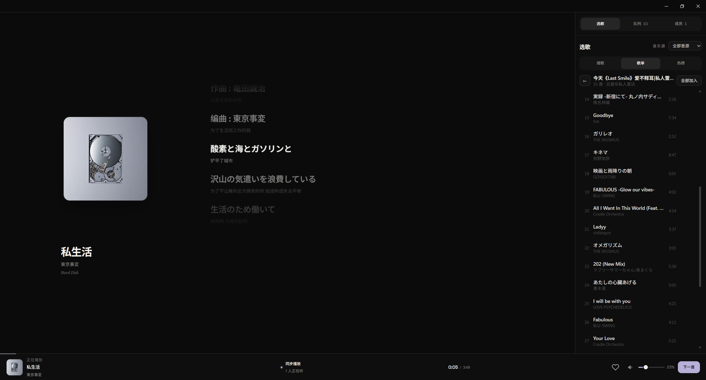

# Lune · 一起听

Lune 是一个自托管的多人同步听歌应用。用户在 Windows 或 Android 客户端连接自己的 Lune 服务，创建房间或通过六位房间码加入；房间成员可以共同选歌、调整进度、切歌和维护队列。

项目不提供公共服务器、预置账号或固定音乐源登录态。使用前需要部署服务端，并由服务管理员登录音乐平台账号。

## 界面预览

## 功能

- Windows 与 Android 双平台
- 实时同步播放状态、队列和成员列表，全员平等控制
- 全员离线后房间与歌单默认保留 24 小时，支持原身份重连与服务重启恢复
- 单曲搜索、歌单搜索、整单加入、歌词和收藏
- 网易云音乐和酷狗音乐源
- Android 后台播放、锁屏媒体卡与耳机断开保护
- 播放故障有界重试、失效地址重新解析和本地诊断导出
- 客户端首次启动配置自建服务器地址

## 开始使用

1. 服务管理员按 [部署与运维指南](docs/DEPLOYMENT.md) 部署单实例服务端。
2. 按 [音乐源配置与管理](docs/PROVIDERS.md) 登录音乐平台账号并检查状态。
3. 在客户端填写服务地址，输入昵称后创建房间，或通过朋友提供的六位房间码加入。
4. 搜索歌曲或歌单，加入播放队列，即可一起听歌。

房间没有暂停操作；本机静音和系统打断不会暂停其他成员的播放。具体操作见 [使用说明](docs/USAGE.md)，连接或声音异常见 [播放与连接故障处理](docs/playback-reliability.md)。

## 文档

- [文档索引](docs/README.md)
- [使用说明](docs/USAGE.md)
- [播放与连接故障处理](docs/playback-reliability.md)
- [音乐源配置与管理](docs/PROVIDERS.md)
- [服务端部署与运维](docs/DEPLOYMENT.md)
- [部署模板说明](server-deploy/README.md)

仓库维护使用与运维文档。内部开发资料保留在本地并由 Git 忽略，不随仓库分发。

## 技术组成

客户端使用 Tauri 2、React 和 TypeScript；服务端使用 NestJS 与 WebSocket。音乐源以进程内 Provider 接入，登录凭据加密保存。服务端配置与部署模板位于 `server-deploy/`。

## 当前限制

- 房间和可恢复身份保存于服务端数据目录；空房默认在连续离线 24 小时后过期。
- 服务端必须单实例运行，多实例之间不会共享房间状态。
- 音乐可用性受上游账号、会员、版权和地区限制。
- 当前不提供用户账号体系或跨服务发现。
- 播放恢复首版已完成静态检查，运行回归与 Windows／Android 真机验收尚待完成。

## License

[MIT](LICENSE)
