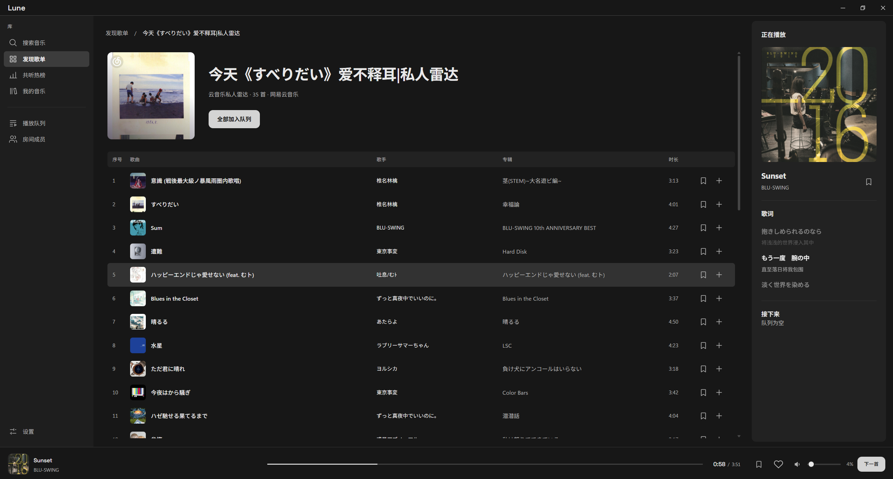
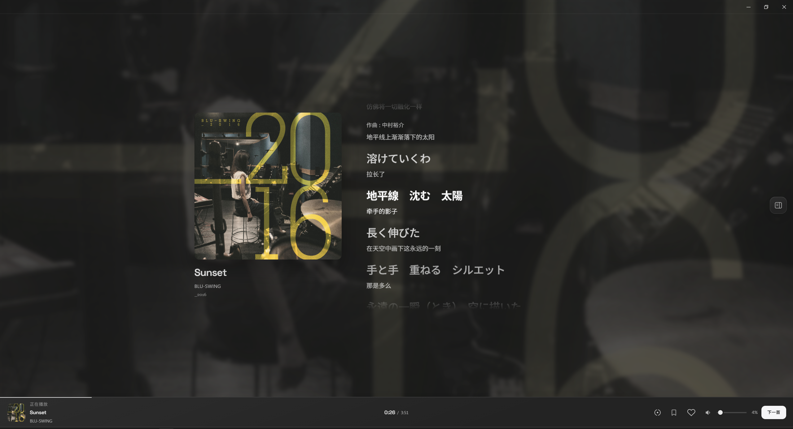

# Lune

自托管的多人同步音乐播放器，支持 Windows 和 Android。

通过六位房间码加入房间，共享播放进度与队列。所有成员都能选歌、切歌和调整进度。服务端由你部署，音乐源账号由管理员配置。

[部署](#部署) · [加入房间](#加入房间) · [文档](docs/README.md) · [MIT](LICENSE)

**功能区** · 浏览歌单、管理队列，同时查看当前歌曲和歌词。

**播放区** · 专辑封面与歌词居中展示。

## 支持什么

| 功能 | 当前行为 |
| --- | --- |
| 同步听歌 | 共享播放进度、队列和成员列表，所有成员均可控制 |
| 搜歌与歌单 | 网易云音乐、酷狗；支持搜索、整单加入与歌词 |
| 记录与收藏 | 保存在本机，按服务器区分，不跨设备同步 |
| 房间恢复 | 短暂断线自动重连；全员离线后默认保留 24 小时 |
| Android 播放 | 后台播放、锁屏媒体控制、耳机断开保护 |

## 部署

Lune 不提供公共服务器。先部署一个服务实例，再通过管理后台登录音乐源。

| 部署方式 | 入口 |
| --- | --- |
| Docker Compose | [Linux 云服务器部署](server-deploy/README.compose.md)，需要可用的发布附件与镜像 |
| Node.js / systemd | [服务端部署与运维](docs/DEPLOYMENT.md) |
| 管理后台 | [管理员说明](server-deploy/ADMIN.md)，通过 SSH 隧道访问，首次设置使用一次性配对码 |

服务端 2.1.0 的变更、升级步骤和验证范围见 [版本说明](server-deploy/releases/v2.1.0.md)。仓库中的部署配置不代表镜像或发布附件已经可用。

## 加入房间

1. 在 Windows 或 Android 客户端填写服务地址。
2. 输入昵称，创建房间或用六位房间码加入。所有人需要连接同一个服务。
3. 搜索歌曲或歌单，加入共同队列。

房间不支持暂停，本机静音不影响其他成员。详细操作见 [使用说明](docs/USAGE.md)。

## 项目结构

| 目录 | 内容 |
| --- | --- |
| apps/client/ | Tauri 2、React、TypeScript 客户端 |
| apps/shared/ | 客户端与服务端共享代码 |
| server/ | NestJS 服务端、WebSocket 同步与音乐源接入 |
| server-deploy/ | 部署模板与管理说明 |
| docs/ | 使用、部署与故障处理文档 |

## 限制与验证范围

- 服务端仅支持单实例，多实例不会共享房间状态。
- 没有用户账号体系或跨服务发现；普通成员无需登录音乐平台。
- 歌曲可用性受账号权限、会员、版权和地区限制。
- Linux 目标环境的安装、升级、恢复，以及 Windows / Android 播放恢复与联调仍待验收。

[连接与播放故障处理](docs/playback-reliability.md) · [音乐源配置](docs/PROVIDERS.md) · [文档索引](docs/README.md)

## License

[MIT](LICENSE)
